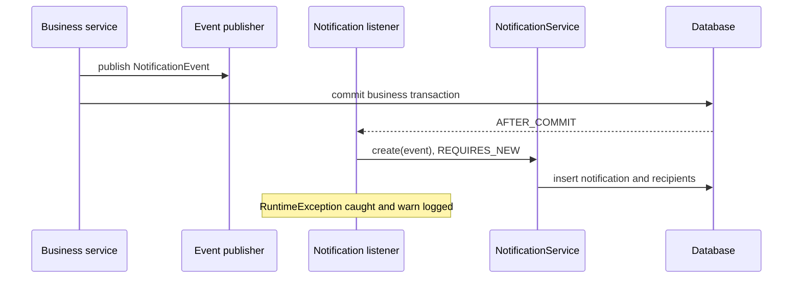
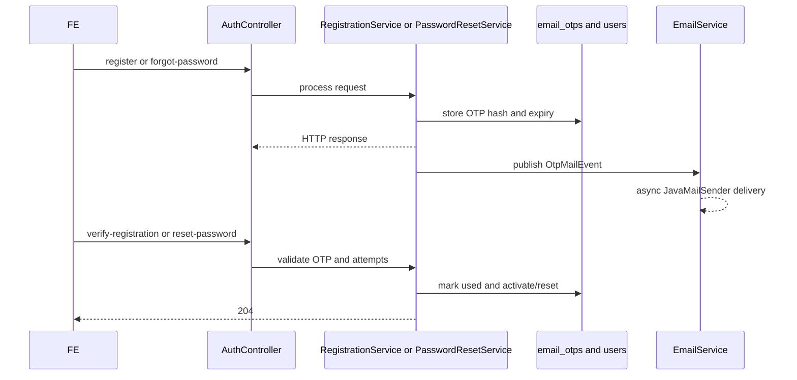

# Notification, OTP qua email và Chat hỗ trợ

> Đối chiếu source hiện tại. Ví dụ JSON dùng dữ liệu giả; các khẳng định về API dựa trên controller/DTO, không dựa vào suy đoán.

## 0. Tổng quan

| Tính năng | Mục đích | Vai trò | Package chính |
|---|---|---|---|
| Notification | Feed, unread count, đánh dấu đã đọc, notification từ nghiệp vụ | User đăng nhập | com.sportscenter.notification; chat |
| OTP email | Xác thực đăng ký Member, đặt lại mật khẩu | Public | com.sportscenter.auth |
| Chat | Hội thoại Member với Receptionist/CenterManager | MEMBER + CHAT_AS_MEMBER; staff + HANDLE_CHAT | com.sportscenter.chat; notification |

Spring MVC controllers, Spring Data JPA/Hibernate, Spring Security session, PostgreSQL dialect và ddl-auto=none được cấu hình trong src/main/resources/application.properties. JavaMailSender được dùng bởi auth/EmailService. Spring event và @TransactionalEventListener(AFTER_COMMIT) dùng cho notification/chat events; @Async dùng cho gửi mail (mailExecutor) và chat responder (chatExecutor). Không tìm thấy WebSocket/SSE cho ba tính năng. Session login lưu SecurityContext qua AuthController.login; FE gọi authenticated API với credentials: 'include' (Fetch) hoặc withCredentials: true (Axios).

| Feature | Migration/schema | Bảng |
|---|---|---|
| Notification | database/migrations/05_migration_notifications.sql | notifications, notification_recipients |
| OTP | database/schema_postgres.sql; không tìm thấy migration OTP trong database/migrations | email_otps, users |
| Chat | database/migrations/06_migration_chat.sql | chat_conversations, chat_messages, chat_read_state, users, permissions/role mappings |

## 1. Notification

### 1.1 Mô tả/phạm vi

Thông báo trong ứng dụng, không phải email/push. Có feed, unread count, mark one/all read. Business services publish event; NotificationScheduleJob phát nhắc buổi học và gói sắp hết hạn. Căn cứ: src/main/java/com/sportscenter/notification/NotificationController.java (listMine, unreadCount, markRead, markAllRead), NotificationService.java, NotificationEventListener.java, NotificationScheduleJob.java. Không có API xóa hoặc realtime.

### 1.2 Công nghệ/cập nhật FE

NotificationEventListener.onNotificationEvent chạy AFTER_COMMIT, gọi NotificationService.create trong transaction REQUIRES_NEW; listener bắt RuntimeException và warn log. Không @Async tại notification listener. Job nhắc buổi chạy fixedDelay 900000 ms; nhắc gói theo cron mặc định 0 5 0 * * * Asia/Ho_Chi_Minh. Không có WebSocket/SSE; FE nên polling unread-count (chu kỳ đề xuất 30–60 giây, do FE chọn). Feed dùng Pageable page/size, không có afterId.

### 1.3 Bản đồ file

| Tầng | File | Class/method | Vai trò |
|---|---|---|---|
| Controller | src/main/java/com/sportscenter/notification/NotificationController.java | NotificationController.listMine, unreadCount, markRead, markAllRead | REST |
| Service | .../NotificationService.java | send, create, listMine, countUnread, markRead, markAllRead | Logic feed/đọc |
| Repository | .../NotificationRepository.java | findMine, countUnreadForUser, update/insert queries | Data access |
| Repository | .../NotificationRecipientRepository.java | JPA repository | Recipient |
| Entity | .../Notification.java; NotificationRecipient.java; NotificationRecipientId.java | Entity/ID | Bảng |
| DTO | .../NotificationEvent.java; NotificationResponse.java; UnreadCountResponse.java | records | Event/JSON |
| Event/job | .../NotificationEventListener.java; NotificationScheduleJob.java; NotificationTemplates.java | listener/job | Async lifecycle/schedule |
| Enum | .../NotificationType.java | NotificationType | Loại |
| Migration | database/migrations/05_migration_notifications.sql | SQL | Cột/index |
| Test | src/test/java/com/sportscenter/notification/ | NotificationControllerTest, NotificationServiceTest, NotificationEventListenerTest, NotificationScheduleJobTest | Tests |

### 1.4 Mô hình dữ liệu

Migration 05 thêm notifications.notification_type VARCHAR(40), related_type VARCHAR(40), related_id INT, dedupe_key VARCHAR(180); unique partial index cho dedupe_key khác null; indexes thời gian. notification_recipients được thêm is_read BOOLEAN default false, read_at, created_at và index (user_id,is_read,created_at DESC). Migration nâng cấp bảng có sẵn, không tạo schema nền.

NotificationResponse: id integer, type string, title, message, relatedType nullable, relatedId nullable integer, isRead boolean, createdAt offset datetime. NotificationType: ENROLLMENT_CONFIRMED, PRIVATE_BOOKING_CONFIRMED, PRIVATE_BOOKING_CANCELLED, SESSION_RESCHEDULED, COACH_SUBSTITUTED, PAYMENT_SUCCESS, PAYMENT_EXPIRED, PACKAGE_EXTENDED, PACKAGE_EXPIRING_SOON, PACKAGE_EXPIRED, CREDIT_LOW, NO_SHOW_RECORDED, SESSION_REMINDER, CHAT_MEMBER_MESSAGE, CHAT_STAFF_REPLY. Nguồn: NotificationResponse.java, NotificationType.java.

### 1.5 Flow



NotificationEvent loại bỏ recipient trùng. create bỏ qua event thiếu type/recipients; dedupeKey trùng sẽ không insert. markRead chỉ sửa notification của user đang gọi; không thuộc user thì NotificationNotFoundException. Nguồn: NotificationEvent.java, NotificationService.create/markRead/markAllRead.

### 1.6 Kết nối/transaction/lỗi

Event được xử lý sau commit, lưu trong transaction mới. Lỗi bị catch và log warn nên không rollback nghiệp vụ gốc; không thấy retry/outbox. Chat notification cũng được phát từ ChatMessageEventListener sau commit.

### 1.7 Cấu hình

application.properties không có cấu hình notification đặc biệt. NotificationScheduleJob có cron property scms.notification.package-expiring-cron với mặc định trong annotation 0 5 0 * * *. Nhắc buổi fixed delay hard-coded. Không thấy thay đổi profile demo cho notification.

### 1.8 Bàn giao FE

| Method | Đường dẫn | Quyền | Đăng nhập |
|---|---|---|---|
| GET | /api/notifications/me | User hiện tại | Có |
| GET | /api/notifications/me/unread-count | User hiện tại | Có |
| PATCH | /api/notifications/{id}/read | Owner | Có |
| PATCH | /api/notifications/me/read-all | User hiện tại | Có |

GET feed query: unreadOnly boolean default false; type NotificationType optional; Pageable page/size. Controller clamp size 1–100, page âm thành 0.

```json
{
  "content": [{
    "id": 42, "type": "SESSION_REMINDER", "title": "Nhắc lịch học",
    "message": "Bạn có buổi học sắp diễn ra.", "relatedType": "SESSION",
    "relatedId": 18, "isRead": false, "createdAt": "2026-10-27T09:00:00+07:00"
  }],
  "totalElements": 1, "totalPages": 1, "size": 20, "number": 0
}
```

Spring Page có thể có thêm metadata tùy phiên bản. unread-count response: {"unreadCount":3}. Mark endpoints trả 204 body rỗng. Errors: unauthenticated 401; notification không thuộc user 404. Error body thực tế phụ thuộc exception handler, chưa xác minh tại controller.

UI: chuông/badge unreadCount; mở chuông tải feed; phân trang page/size; PATCH read khi click và read-all cho nút tương ứng; refresh badge sau 204. Polling là lựa chọn FE, không có interval server. CORS allowlist cụ thể chưa xác minh ở controller.

### 1.9 Test nhanh

Swagger: đăng nhập lấy session, gọi unread-count/feed, PATCH read/read-all. Sinh notification qua business flow; job nhắc buổi chỉ chọn session Scheduled trong cửa sổ từ now+24h đến now+24h15m. Tests ở src/test/java/com/sportscenter/notification/.

### 1.10 Hạn chế

Không realtime; offset pagination; lỗi listener bị nuốt sau warn log, không retry; type cũ có fallback. Error JSON cần đối chiếu exception handler.

## 2. OTP qua email

### 2.1 Mô tả/phạm vi

Đăng ký Member Pending, verify OTP; forgot/reset password. OTP được hash bằng PasswordEncoder trước khi lưu. Căn cứ src/main/java/com/sportscenter/auth/RegistrationService.java (register, verify, issueOtp), PasswordResetService.java (requestReset, reset), EmailOtp.java. OTP 10 phút, tối đa 5 lần sai, resend chờ 60 giây và tối đa 3 lần/giờ theo email/purpose.

### 2.2 Cơ chế

EmailService.sendAfterCommit dùng @Async("mailExecutor"), gửi qua JavaMailSender. API có thể thành công trước khi SMTP delivery xác định; EmailService bắt lỗi send, log warn và trả false. Không WebSocket/SSE. Không có API kiểm tra trạng thái gửi.

### 2.3 Bản đồ file

| Tầng | File | Class/method | Vai trò |
|---|---|---|---|
| Controller | src/main/java/com/sportscenter/auth/AuthController.java | register, verifyRegistration, resendOtp, forgotPassword, resetPassword | REST public |
| Service | .../RegistrationService.java | register, verify, resend, issueOtp | OTP đăng ký |
| Service | .../PasswordResetService.java | requestReset, resend, reset, storeOtp | OTP reset |
| Mail | .../EmailService.java | sendAfterCommit, sendOtpEmail, send | Async SMTP |
| Repository | .../EmailOtpRepository.java | quota/latest/unused queries | Tra OTP |
| Entity | .../EmailOtp.java | EmailOtp | email_otps |
| DTO | .../RegisterRequest.java, VerifyRegistrationRequest.java, ResendOtpRequest.java, ForgotPasswordRequest.java, ResetPasswordRequest.java, OtpMessageResponse.java | records | JSON |
| Event | .../OtpMailEvent.java | OtpMailEvent | Mail event |
| Config/schema | src/main/resources/application.properties, application-demo.properties; database/schema_postgres.sql | Spring Mail/demo; email_otps | Cấu hình/schema |
| Test | src/test/java/com/sportscenter/auth/ | Auth tests | Không xác định riêng danh sách OTP test |

### 2.4 Mô hình dữ liệu

email_otps: otp_id, email, nullable user_id FK, purpose, otp_hash, expires_at, attempts, used, created_at. schema_postgres.sql có index email/purpose/created_at. Purpose dùng REGISTER hoặc RESET_PASSWORD trong service; không thấy CHECK/UNIQUE constraint tương ứng.

### 2.5 Flow



Registration email Active bị từ chối EMAIL_ALREADY_REGISTERED; Pending registration phát OTP mới và giữ thông tin cũ. Forgot trả thông điệp chung, không tiết lộ email tồn tại. Verify/reset yêu cầu OTP hợp lệ, còn hạn, chưa used; sai OTP tăng attempts. Đủ 5 lần thì hết hiệu lực. Nguồn RegistrationService và PasswordResetService. RegistrationService dùng purpose REGISTER, còn PasswordResetService dùng RESET_PASSWORD. EmailService.sendOtpEmail nhận diện REGISTER là mail đăng ký; purpose khác dùng nội dung đặt lại mật khẩu.

### 2.6 Transaction/lỗi

OTP được lưu trước khi event mail xử lý async. SMTP exception bị catch/log warn, không retry; người dùng có thể nhận HTTP success nhưng không nhận mail. RegistrationService.issueOtp kiểm tra mail configuration trừ khi demo OTP bật. PasswordResetService.requestReset không thấy cùng guard isConfigured; có thể ghi OTP mà mail không gửi được.

### 2.7 Cấu hình

| Env | Ý nghĩa | Default |
|---|---|---|
| MAIL_HOST | SMTP host | smtp.gmail.com |
| MAIL_PORT | SMTP port | 587 |
| MAIL_USERNAME | Tài khoản SMTP | rỗng |
| MAIL_APP_PASSWORD | SMTP App Password | rỗng |
| REGISTRATION_DEMO_OTP | OTP demo registration opt-in | rỗng |

Khai báo src/main/resources/application.properties. application-demo.properties giữ REGISTRATION_DEMO_OTP opt-in và tắt mail health indicator. Không ghi giá trị bí mật. RegistrationService inject uppercase REGISTRATION_DEMO_OTP; application.properties cũng có property registration.demo-otp nhưng service không dùng property lowercase này. Demo OTP chỉ áp dụng registration.

### 2.8 Bàn giao FE

| Method | Đường dẫn | Đăng nhập |
|---|---|---|
| POST | /api/auth/register | Không |
| POST | /api/auth/verify-registration | Không |
| POST | /api/auth/resend-otp | Không |
| POST | /api/auth/forgot-password | Không |
| POST | /api/auth/reset-password | Không |

Request DTO mẫu (email/password giả):

```json
{"fullName":"Nguyen Van A","email":"member@example.test","password":"ExamplePass123!","phone":"0900000000","gender":"Male","dateOfBirth":"2000-01-01"}
```

RegisterRequest fields trên; validation chi tiết xem RegisterRequest.java. Verify body: {"email":"member@example.test","otp":"123456"}. Resend: {"email":"member@example.test","purpose":"REGISTRATION"}. Forgot: {"email":"member@example.test"}. Reset: {"email":"member@example.test","otp":"123456","newPassword":"NewExamplePass123!"}. DTO nguồn: VerifyRegistrationRequest, ResendOtpRequest, ForgotPasswordRequest, ResetPasswordRequest.

register trả 200 OtpMessageResponse (message, code nullable); verify/reset trả 204. forgot/resend trả 200 message và code null. Mã cần xử lý: EMAIL_ALREADY_REGISTERED (email đã đăng ký), REGISTRATION_PENDING (tiếp tục xác thực), MAIL_NOT_CONFIGURED (liên hệ vận hành), OTP_RESEND_TOO_SOON (đếm giây từ message), OTP_RESEND_LIMIT (đợi quota), OTP_INVALID (nhập lại), OTP_EXPIRED (yêu cầu mã mới), OTP_ATTEMPTS_EXCEEDED (hết lượt, resend). PasswordResetService có lỗi tổng quát “OTP is invalid or expired” nên FE cũng cần fallback message. GlobalExceptionHandler.business chuyển BusinessException có prefix mã in hoa thành HTTP 400 JSON {"code":"...","message":"..."}; không có prefix trả timestamp/status/error/message. Validation là 400 với timestamp/status/error/message.

UI: form register → nhập OTP; cooldown resend tối thiểu 60 giây; forgot form → generic confirmation → OTP + newPassword. Không cần cookie cho OTP. Không hiển thị khác biệt tồn tại email ở forgot. Demo OTP chỉ registration.

### 2.9 Test nhanh

Swagger/Postman với email thử nghiệm và mail sandbox: register, lấy mã từ test inbox, verify; forgot-password, nhận mã, reset-password, login. Resend ngay để kiểm tra cooldown. Tài liệu này không gửi mail thật và không ghi tài khoản/password seed.

### 2.10 Hạn chế

SMTP send async và lỗi bị nuốt thành warn; không delivery receipt/retry. Password reset thiếu guard cấu hình rõ ràng trong service. Demo OTP không áp dụng reset. ResendOtpRequest bắt buộc purpose. Error status/body chưa xác minh toàn bộ.

## 3. Chat Member ↔ Receptionist/CenterManager

### 3.1 Mô tả/phạm vi

Chat lưu hội thoại/tin nhắn DB. Member tạo/lấy OPEN conversation. Staff có HANDLE_CHAT xem inbox, claim/release, close/reopen, trả lời. Có ChatResponder abstraction và async dispatcher, nhưng conversation mới mặc định handlerType STAFF; không tìm thấy API FE đổi sang AI. Nguồn src/main/java/com/sportscenter/chat/ChatController.java và ChatService.java.

### 3.2 Realtime/polling

Không WebSocket/SSE. GET messages hỗ trợ afterId (exclusive ID) và limit. FE poll 2–5 giây khi chat mở (gợi ý, không phải cấu hình server); inbox 10–30 giây. ChatService gửi đồng bộ trong transaction; event notification chạy AFTER_COMMIT; ChatResponderDispatcher.onMemberMessage chạy @Async("chatExecutor") nếu handler AI.

### 3.3 Bản đồ file

| Tầng | File | Class/method | Vai trò |
|---|---|---|---|
| Controller | src/main/java/com/sportscenter/chat/ChatController.java | endpoints getOrCreate, active, unread, messages, send, read, inbox, claim, release, close, reopen | REST |
| Service | .../ChatService.java | getOrCreate, active, memberUnread, listMessages, sendMessage, markRead, inbox, claim/release, close/reopen | Nghiệp vụ/transaction |
| Repository | .../ChatConversationRepository.java; ChatMessageRepository.java; ChatReadStateRepository.java | lock, inbox, cursor, read state | Data |
| Entity | .../ChatConversation.java; ChatMessage.java; ChatReadState.java; ChatReadStateId.java | Entity | Bảng |
| DTO | .../ChatConversationRequest.java; ChatConversationResponse.java; ChatMessageRequest.java; ChatMessageResponse.java; ChatUnreadCountResponse.java | records | JSON |
| Event | .../ChatMessageCreatedEvent.java; ChatMessageEventListener.java | onMessage | Notification after commit |
| Responder | .../ChatResponder.java; ChatResponderDispatcher.java; ChatResponderReply.java | onMemberMessage | AI adapter |
| Enum/error | .../ChatConversationStatus.java; ChatHandlerType.java; ChatSenderType.java; ChatException.java | enums/error | Trạng thái |
| Migration | database/migrations/06_migration_chat.sql | SQL | Tables/permissions |
| Test | src/test/java/com/sportscenter/chat/ | ChatServiceTest, ChatControllerTest, ChatMessageEventListenerTest, ChatResponderDispatcherTest | Tests |

### 3.4 Mô hình dữ liệu

| Table | Cột/ràng buộc |
|---|---|
| chat_conversations | member_user_id FK users cascade; status CHECK OPEN/CLOSED; assigned_staff_user_id FK set null; handler_type CHECK STAFF/AI; subject max 200; unique partial một OPEN/member |
| chat_messages | conversation_id FK cascade; sender_type CHECK MEMBER/STAFF/AI/SYSTEM; nullable sender_user_id FK set null; content/content_type/metadata/client_message_id; unique partial (conversation_id,sender_user_id,client_message_id) khi clientMessageId khác null |
| chat_read_state | PK (conversation_id,user_id); FK conversation/user cascade; last_read_message_id FK set null |

Enums: ChatConversationStatus OPEN/CLOSED; ChatHandlerType STAFF/AI; ChatSenderType MEMBER/STAFF/AI/SYSTEM. Migration seed CHAT_AS_MEMBER cho MEMBER và HANDLE_CHAT cho RECEPTIONIST/CENTERMANAGER nếu roles đã tồn tại. Nguồn migration 06 và enum files.

### 3.5 Flow

```mermaid
sequenceDiagram
    participant M as Member FE
    participant C as ChatController
    participant S as ChatService
    participant D as Chat tables
    participant L as ChatMessageEventListener
    participant N as NotificationService
    M->>C: POST /conversations
    C->>S: getOrCreate
    S->>D: lock member; find or create OPEN
    S-->>M: ChatConversationResponse
    M->>C: POST /conversations/{id}/messages
    C->>S: sendMessage(content, clientMessageId)
    S->>D: lock conversation; validate; persist
    S-->>M: ChatMessageResponse
    S-->>L: event after commit
    L->>N: create notification on unread transition
    M->>C: GET messages?afterId=lastId
    C->>S: listMessages
    S->>D: select IDs greater than cursor
    S-->>M: ordered message array
```

Member Active và chỉ conversation của mình; role MEMBER + CHAT_AS_MEMBER khi create/active/unread. Staff phải Receptionist/CenterManager + HANDLE_CHAT. Content trim, không rỗng, tối đa 2000; Member không gửi CLOSED; 20 messages/user/minute. clientMessageId trùng sender+conversation trả tin cũ (idempotency). Lock conversation/user bảo vệ cập-update và unique index chặn hai OPEN. Nguồn ChatService.

### 3.6 Transaction/lỗi

ChatService mutating methods @Transactional; getOrCreate khóa user, send/read/claim/close khóa conversation qua repository. Notification listener AFTER_COMMIT; lỗi bị warn log. Async responder catch/log exception. Không có retry/event queue.

### 3.7 Cấu hình

Không tìm thấy chat-specific property/profile demo. chatExecutor/mailExecutor được tham chiếu bởi @Async nhưng nơi khai báo bean chưa xác minh. CORS origin cụ thể chưa xác minh trong controller.

### 3.8 Bàn giao FE

| Method | Path | Quyền | Login |
|---|---|---|---|
| POST | /api/chat/conversations | MEMBER + CHAT_AS_MEMBER | Có |
| GET | /api/chat/conversations/me/active | MEMBER + CHAT_AS_MEMBER | Có |
| GET | /api/chat/me/unread-count | MEMBER + CHAT_AS_MEMBER | Có |
| GET | /api/chat/conversations/{id}/messages | owner hoặc staff HANDLE_CHAT | Có |
| POST | /api/chat/conversations/{id}/messages | owner hoặc staff HANDLE_CHAT | Có |
| POST | /api/chat/conversations/{id}/read | owner hoặc staff HANDLE_CHAT | Có |
| GET | /api/chat/conversations | HANDLE_CHAT | Có |
| POST | /api/chat/conversations/{id}/claim | HANDLE_CHAT | Có |
| POST | /api/chat/conversations/{id}/release | HANDLE_CHAT | Có |
| PATCH | /api/chat/conversations/{id}/close | HANDLE_CHAT | Có |
| PATCH | /api/chat/conversations/{id}/reopen | HANDLE_CHAT | Có |

Tạo conversation body optional, DTO ChatConversationRequest: {"subject":"Hỏi lịch học"}. Response ChatConversationResponse:

```json
{
  "id": 12, "memberUserId": 7, "memberName": "Nguyen Van A",
  "status": "OPEN", "assignedStaffUserId": null, "assignedStaffName": null,
  "handlerType": "STAFF", "subject": "Hỏi lịch học",
  "createdAt": "2026-10-27T10:00:00+07:00", "updatedAt": "2026-10-27T10:00:00+07:00",
  "lastMessageAt": null, "closedAt": null, "lastMessage": null, "unreadCount": 0
}
```

Messages query afterId default 0, limit default 30/clamp 1–50. Response array ChatMessageResponse:

```json
[{"id":31,"conversationId":12,"senderType":"MEMBER","senderName":"Nguyen Van A","isMine":true,"content":"Xin chào","contentType":"TEXT","metadata":null,"clientMessageId":"ui-req-001","createdAt":"2026-10-27T10:01:00+07:00"}]
```

Send body (ChatMessageRequest): {"content":"Xin chào","clientMessageId":"ui-req-002"}. Response one ChatMessageResponse. unread endpoint: {"unreadCount":2}. Inbox query status=OPEN|CLOSED, assigned boolean, unreadOnly boolean default false, page default 0, size default 30 (clamp 1–100), response Spring Page<ChatConversationResponse>. read returns 204. claim/release/close/reopen return ChatConversationResponse JSON.

ChatException codes: CHAT_ACTIVE_CONVERSATION_NOT_FOUND (tạo/lấy conversation), CHAT_CONVERSATION_NOT_FOUND (refresh), CHAT_MESSAGE_EMPTY, CHAT_MESSAGE_TOO_LONG, CHAT_CONVERSATION_CLOSED (disable composer/mở mới), CHAT_RATE_LIMITED (cooldown bằng retryAfterSeconds), CHAT_ALREADY_CLAIMED (refresh inbox), CHAT_NOT_ASSIGNED_TO_ACTOR (refresh assignment), CHAT_OPEN_CONVERSATION_EXISTS (dùng active conversation). 401 login; 403 thiếu quyền. GlobalExceptionHandler.chat trả {"code":"...","message":"..."}, thêm retryAfterSeconds và header Retry-After nếu có.

UI Member: support entry, conversation, message list/composer, unread badge. Poll afterId=highest message id; sau khi xem gọi read. Mỗi lần send tạo clientMessageId UUID; retry cùng UUID để tránh duplicate. Staff: inbox filters, claim, chat, release/close/reopen. Gọi bằng session cookie credentials include. 409 refresh trạng thái; 429 đếm cooldown. Status enums OPEN/CLOSED, handlerType STAFF/AI, senderType MEMBER/STAFF/AI/SYSTEM; contentType hiện ghi TEXT.

### 3.9 Test nhanh

Login Member có quyền, POST conversation, gửi, poll afterId, read. Login Receptionist/CenterManager có HANDLE_CHAT, inbox, claim, reply, close/reopen. Không nêu tài khoản/password seed vì chưa xác minh. Tests tại src/test/java/com/sportscenter/chat/.

### 3.10 Hạn chế

Không realtime. ChatMessageRequest không có validation annotation; ChatService tự kiểm tra content. Message GET/send/read dựa service-level access check thay vì @PreAuthorize controller. AI responder tồn tại nhưng conversation tạo mới là STAFF, không thấy API đổi handler. GlobalExceptionHandler.chat trả JSON có code/message; NotificationNotFoundException trả 404 với NOTIFICATION_NOT_FOUND.

## Phụ lục

### A. Toàn bộ endpoints

| Method | Endpoint | Tính năng | Access |
|---|---|---|---|
| GET | /api/notifications/me | Notification | Authenticated |
| GET | /api/notifications/me/unread-count | Notification | Authenticated |
| PATCH | /api/notifications/{id}/read | Notification | Owner |
| PATCH | /api/notifications/me/read-all | Notification | Authenticated |
| POST | /api/auth/register | OTP | Public |
| POST | /api/auth/verify-registration | OTP | Public |
| POST | /api/auth/resend-otp | OTP | Public |
| POST | /api/auth/forgot-password | OTP | Public |
| POST | /api/auth/reset-password | OTP | Public |
| POST | /api/chat/conversations | Chat | MEMBER + CHAT_AS_MEMBER |
| GET | /api/chat/conversations/me/active | Chat | MEMBER + CHAT_AS_MEMBER |
| GET | /api/chat/me/unread-count | Chat | MEMBER + CHAT_AS_MEMBER |
| GET | /api/chat/conversations/{id}/messages | Chat | Owner or HANDLE_CHAT |
| POST | /api/chat/conversations/{id}/messages | Chat | Owner or HANDLE_CHAT |
| POST | /api/chat/conversations/{id}/read | Chat | Owner or HANDLE_CHAT |
| GET | /api/chat/conversations | Chat | HANDLE_CHAT |
| POST | /api/chat/conversations/{id}/claim | Chat | HANDLE_CHAT |
| POST | /api/chat/conversations/{id}/release | Chat | HANDLE_CHAT |
| PATCH | /api/chat/conversations/{id}/close | Chat | HANDLE_CHAT |
| PATCH | /api/chat/conversations/{id}/reopen | Chat | HANDLE_CHAT |

### B. Biến môi trường

| Env | Required | Default | Feature |
|---|---|---|---|
| MAIL_HOST | No | smtp.gmail.com | OTP |
| MAIL_PORT | No | 587 | OTP |
| MAIL_USERNAME | Optional config; needed for real SMTP | empty | OTP |
| MAIL_APP_PASSWORD | Optional config; needed for SMTP auth | empty | OTP |
| REGISTRATION_DEMO_OTP | No | empty/off | OTP registration only |

DB_URL/DB_USERNAME/DB_PASSWORD là cấu hình ứng dụng chung trong application.properties, không ghi giá trị ở đây. PORT là server chung. Không thấy env riêng của notification/chat.

### C. Migration và xác minh

1. Cần schema nền gồm users/roles/permissions/role_permissions và bảng notification cũ.
2. Chạy 05_migration_notifications.sql.
3. Xác minh cột notification_type, related_type, related_id, dedupe_key; recipient is_read/read_at/created_at; indexes uq_notifications_dedupe_key, idx_notification_recipients_feed, idx_notifications_created_at.
4. Chạy 06_migration_chat.sql.
5. Xác minh ba bảng chat, CHECK/FK/indexes, permissions CHAT_AS_MEMBER/HANDLE_CHAT và role mappings.
6. email_otps được định nghĩa trong database/schema_postgres.sql; xác minh bảng và idx_email_otps_quota.
7. ddl-auto=none nên Hibernate không tự tạo schema. Không chạy migration hoặc ghi DB khi tạo tài liệu; xác nhận bằng catalog PostgreSQL hoặc quy trình deploy. Không tìm thấy migration ledger trong source.

## Chưa chắc chắn / không tìm thấy

- Global exception/security handlers quyết định body/status cuối của lỗi validation, BusinessException, ChatException và NotificationNotFoundException; cần xác nhận ở runtime.
- CORS allowlist và executor bean chatExecutor/mailExecutor chưa xác định trong phần code feature đã tra.
- Polling interval là gợi ý UI, backend không quy định.
- Không xác minh tài khoản seed phù hợp; không đưa thông tin đăng nhập vào tài liệu.
- Không tìm thấy OTP migration trong database/migrations; bảng hiện được định nghĩa trong schema_postgres.sql.
- Không xác nhận SMTP delivery và không gửi email thật.

**Bảo mật:** Tài liệu không chứa mật khẩu thật, App Password, API key, connection string DB hoặc dữ liệu cá nhân thật. Email và tên trong JSON là dữ liệu giả.
