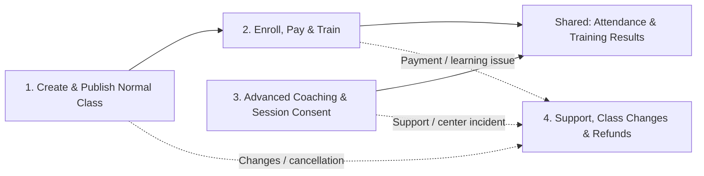

# Kịch bản demo SCMS — 4 flow

Bản đề xuất **14/11/2026**, phát triển từ ba sơ đồ Owner gửi; thời lượng **15–20 phút**. Thay bố cục F1–F5 trước đây tại cùng file. Các nhãn tiếng Anh dưới đây để vẽ slide, chưa phải tên nút FE đã xác minh. Đây là thiết kế demo, chưa là kết quả rehearsal; trạng thái triển khai/nghiệm thu xem [Active/QA](../00-MASTER-CHECKLIST.md#active).

## 1. Các điểm cần chỉnh trong ba sơ đồ

| Flow | Điểm gây hiểu sai | Đề xuất sửa |
|---|---|---|
| 1 | Hai hộp Configure Class Schedule, hộp thứ hai dùng icon tiền | **Set Schedule** và **Set Tuition & Capacity** |
| 1 | Save Class chưa phân biệt lưu nháp/công bố/khai giảng | Nháp Closed/pricingDraft; đủ 12 buổi mới **Publish → Open**; xác nhận khai giảng và Ongoing là bước sau |
| 1 | Thiếu kiểm trước lưu | Chuyên môn/lịch làm Coach, sân/sức chứa, ca/ngày nghỉ/Outdoor và trùng tài nguyên; preview chưa giữ chỗ |
| 2 | Browse Catalog → Course Registration → Select Class lặp bước menu | **Browse Normal Classes → View Class & Schedule → Enroll**; bỏ Dashboard lặp nếu không cần trình bày giao diện |
| 2 | Payment → Registered thiếu xác minh | **Valid Paid + eligible → Registered**; Return/URL thành công chưa đủ |
| 2 | Chưa tách Cash và VNPay theo vai | Member trả VNPay; Receptionist thu Normal Cash tại quầy và tạo Paid+Registered nguyên khối |
| 2 | AI/Manual Chatbox chen giữa hai màn xem lịch | **AI Assistant / Staff Support** ở nhánh tư vấn trước chọn khóa hoặc Flow 4 |
| 2–3 | QR rồi Mark Present như hai bước bắt buộc | QR **hoặc** thủ công; đọc lại attendance rồi ghi chuyên môn riêng. QR không tạo nhận xét |
| 3 | Member Orders within 24h dễ bị hiểu là hạn trả tiền | **Confirm Purchase within 24h of Coach Acceptance → Pending Invoice, expires in 5min** |
| 3 | Enrollment Active lẫn thuật ngữ Normal/Advanced | Normal **Enrollment Registered**; Advanced **Learning Entitlement Active — 12 credits / 45 usable days** |
| 3 | Coach Schedule Private Session bỏ qua xác nhận học viên | **Agree Outside SCMS → Coach Sends Proposal → Member Accepts → Scheduled, −1 credit** |
| 3 | Save Attendance = Session Finalized | **Attendance Saved**; hoàn tất buổi theo end/job, không do nút lưu điểm danh |
| 2–3 | Mua/đặt ca tương lai rồi đi học ngay | Chuyển rõ sang buổi chuẩn bị đang trong giờ hoặc lịch sử; không giả cùng buổi vừa đặt |

Thống nhất **Normal/Advanced, Member, Coach, Receptionist, Center Manager**. Dùng Register Account cho tài khoản, Enroll cho Normal, Request Coaching cho đăng ký Advanced. “Advanced 1:1” mô tả học riêng, không đổi lại tên danh mục đã bỏ “(1:1)”.

## 2. Bố cục và thời lượng

| Phần | 15 phút | 20 phút | Ưu tiên |
|---|---:|---:|---|
| Mở đầu | 0:30 | 0:30 | Năm vai, dữ liệu DEMO, VNPay sandbox |
| Flow 1 | 2:30 | 3:00 | Tạo/công bố Normal và 12 buổi |
| Flow 2 | 3:30 | 4:30 | Paid/ghi danh, attendance/kết quả |
| Flow 3 | 4:00 | 5:00 | 24h xác nhận mua, đề xuất/Accept, credit |
| Flow 4 | 3:00 | 4:00 | AI→staff, một nhánh thay đổi/hoàn tiền |
| Dự phòng/hỏi đáp | 1:30 | 3:00 | Hồ sơ đã chuẩn bị |

Bao phủ feature bằng **đường chính + nhánh phụ + hồ sơ có sẵn**. Không chạy tất cả nhánh nối tiếp trong 15–20 phút; sai quyền, biên thời gian và retry/race thuộc bộ kiểm riêng.

**Khi vẽ slide:** mỗi vai một hàng; mũi tên giữ một chiều, đổi vai bằng đường nối rõ. Dùng hình thoi cho Accept/Reject, Paid/Unconfirmed; hộp nét đứt cho trao đổi/chuyển tiền ngoài SCMS. Tách Flow 3 thành hai đoạn Mua quyền / Đặt buổi; dùng nhãn kết quả xanh Open, Registered, Scheduled hoặc Completed thay cho một dấu tick chung.

## 3. Flow 1 — NORMAL CLASS SETUP AND PUBLICATION

**Chuỗi hộp:** Center Manager Sign In → Class Management → Create Normal Class → Select Subject → Assign Qualified Coach → Select Room → Set Schedule → Set Tuition & Capacity → Preview 12 Sessions → Create & Publish → Class Open.

- **Manager:** chọn môn, Coach, sân, ngày bắt đầu/ngày trong tuần và một trong 7 ca 90 phút. Học phí dương; max không vượt phòng hoặc 15; min mặc định ceil(2×max/3), chỉ tăng trong giới hạn.
- **BE:** kiểm chuyên môn, lịch làm, Holiday/Outdoor, trùng sân/Coach; lưu lớp và 12 buổi nguyên khối. Lỗi không để lại nửa lớp/nửa lịch.
- **Thành công:** reload thấy lớp Open, học phí/sĩ số và 12 buổi; Member xem lịch trước mua. Preview chưa giữ tài nguyên; Open chưa là Ongoing.
- **Nối Flow 2:** đủ Paid+Registered thì Manager Confirm Opening trước buổi đầu; tới giờ job kiểm lại rồi Ongoing. Có thể dùng lớp đủ sĩ số chuẩn bị riêng.

**Nhánh phụ:** nháp; preview trùng/ngày nghỉ; thiếu sĩ số; dời/chuyển/hủy chuyển Flow 4. Đăng ký đóng tại T−48h; xác nhận khai giảng từ T−24h tới trước T cần lý do. Không nhập nhằng hai hạn.

## 4. Flow 2 — NORMAL ENROLLMENT, PAYMENT AND TRAINING

**Chuỗi hộp:** Register Account → Verify Email OTP → Sign In → Browse Normal Classes → View Class & Schedule → Enroll → Pay via VNPay Sandbox → Verify Payment & Enrollment → View My Schedule → Attend Prepared Session → View Attendance & Training Results.

- **Tài khoản:** đã có tài khoản đi thẳng Sign In; Google là nhánh thay thế. OTP hợp lệ kích hoạt tài khoản rồi đăng nhập, không mặc định tự tạo phiên. Profile/avatar/mật khẩu là nhánh phụ.
- **Member:** chọn Open còn chỗ/còn hạn; BE lấy giá lớp và đóng băng Invoice. Tạo Pending ngay lúc demo; hạn tối đa 5 phút, không vượt cutoff đăng ký.
- **Sau Return:** BE xác minh IPN/QueryDR; FE đọc lại Invoice/ghi danh. Chỉ thành công khi Paid hợp lệ, không reconciliationRequired, Enrollment Registered và reload vẫn đúng. Chưa rõ không mời trả thêm ngay.
- **Cash thay thế:** Receptionist gửi memberId+paymentMethod:Cash; Paid+Registered cùng transaction. Không gọi confirm-cash lần nữa, không thu Cash cho đơn đã trả VNPay.
- **Chuyển cảnh:** nói “Tôi chuyển sang buổi học đã chuẩn bị”. Chỉ ghi attendance trong [start,end) của buổi hợp lệ; ngoài giờ xem lịch sử.

**Khối học tập dùng chung Flow 2/3:** Member xem lịch/giáo án → tới đúng buổi → Coach quét QR của Member **hoặc** điểm danh thủ công Present/Absent → đọc lại attendance → Coach ghi kết quả/nhận xét → Member xem kết quả/đánh giá tiến độ của mình. Không trừ credit lần hai khi điểm danh.

QR theo buổi khác check-in cửa Reception; QR không tạo training result. Trong buổi dùng POST để ghi chuyên môn; sau end chỉ PATCH content của result có sẵn, đúng Coach/tác giả và trước 00:00 ngày kế tiếp ngày buổi. Save Attendance không chốt Session. Feedback là nhánh Normal đủ điều kiện: Ongoing/Closed, Registered/Completed và đã có Present; một Member/một feedback/lớp.

**Nhánh phụ:** OTP sai/hết hạn/resend; Google onboarding; Reception tạo Member/mật khẩu tạm; đầy lớp→Waitlisted chưa có quyền; thanh toán hết hạn/đối soát; Cash sai vai; QR hết hạn/replay; correction có lý do. Normal không cần gói chung/credit Advanced; Member nghỉ cá nhân mất buổi, không bù.

## 5. Flow 3 — ADVANCED COACHING: REGISTRATION, PAYMENT AND SESSION CONSENT

**Mua quyền:** Member Sign In → Browse Subjects & Coaches → Select Subject & Primary Coach → Request Coaching → Coach Reviews → Coach Accepts → Member Confirms Purchase within 24h → Pending Invoice, 5min → Valid Payment → Learning Entitlement Active.

**Đặt buổi:** Agree Schedule Outside SCMS → Coach Sends Date/Slot/Room Proposal → Member Reviews → Member Accepts → BE Rechecks → Session Scheduled, −1 Credit → My Schedule. Học tập dùng [khối chung](#training-block) trên buổi chuẩn bị riêng.

- Coach nhận đăng ký mới có lớp riêng đúng Member; Requested/Rejected chưa có lớp. Có lớp chưa là đã trả tiền hoặc đặt buổi.
- 24h từ acceptedAt là hạn xác nhận mua/tạo đơn; Invoice có hạn 5 phút riêng. Advanced Cash cần Receptionist confirm-cash Pending còn hạn, khác Normal Cash nguyên khối.
- Paid hợp lệ mới Active/12 credit và bắt đầu 45 ngày sử dụng, có xử lý thời gian TT nghỉ/đóng; dùng expiresAt BE trả. Không gọi là 45 ngày lịch liên tục.
- Ngày linh hoạt nhưng giữ 7 ca 90 phút, lịch làm/sân/Holiday/Outdoor. Chưa có chat Member–Coach hoặc ghép lịch rảnh tự động.
- Pending proposal **chưa giữ sân/Coach/credit**. Member Accept còn >=12h, đủ quyền/credit và cuối ca không vượt hạn mới tạo Scheduled/trừ 1 nguyên khối; có thể trùng tài nguyên phát sinh lúc Accept.
- **Ví dụ kiểm:** 12 credit → đề xuất vẫn 12/chưa có Session → Accept còn 11/có Session → hủy sớm >=12h: Cancelled/trở lại 12, hạn không đổi. Retry không nhân buổi hoặc credit.

**Nhánh phụ:** Coach từ chối; hết 24h; Invoice hết 5 phút; từ chối/hết hạn đề xuất; Accept trùng lịch/hết credit/hết quyền. Hủy sớm >=12h hoàn 1; 0<notice<12h báo vắng, không hoàn/không trừ thêm; không tới học thì Absent và mất credit đã giữ. Dời/thay Coach/sự cố TT có hồ sơ/consent riêng, không dùng Cancel thường để mở ngoại lệ.

## 6. Flow 4 — MEMBER SUPPORT, CLASS CHANGES AND REFUNDS

**Câu chuyện:** trung tâm có phương án thay đổi trước khai giảng; Member hỏi hỗ trợ rồi chọn chuyển lớp hoặc nhận hoàn. Chat và hồ sơ nghiệp vụ riêng; nhân viên mở đúng hồ sơ xử lý, tin nhắn không tự đổi lịch/duyệt/hoàn tiền.

**Hỗ trợ:** Member Opens Support Chat → AI Answers / Suggests Staff → Member Requests Staff → Receptionist Claims Conversation → Staff Replies → Member Views Reply. AI phụ thuộc cấu hình; không gọi nhân viên là Manual Chatbot hoặc hứa chọn tùy ý người nhận. Đóng/mở lại theo quyền, giữ lịch sử.

**Thay đổi Normal:** Manager Proposes Postponement/Transfer → Member Reviews Exact Schedule → Accepts **hoặc** Chooses Refund. Dời cần đủ phản hồi rồi Manager apply; chuyển kiểm lại chỗ/lịch và áp quyền đích khi Member Accept. Không thu lại; Invoice giữ lớp/amount gốc, entitlementClassId chỉ lớp nhận quyền hiện tại. Im lặng chưa là đồng ý.

**Hoàn tiền:** Refund Obligation Created → Member Provides Receiver → Manager Verifies Receiver & Approves → Receptionist Claims Refund → Bank Transfer Outside SCMS → Record Transfer & Upload Proof → Manager Reconciles → Completed / NeedsReview → View Notifications & Reports.

- Nguồn hoàn: TT hủy trước khai giảng, Member chọn Refund trong phương án hợp lệ hoặc thu muộn sau TT hủy. Không phải Member tự hủy Normal đang học là được hoàn.
- Receiver do Member cung cấp riêng, không tự lấy từ profile/thẻ VNPay. Manager duyệt trước; cuối luồng là đối soát kết quả chuyển, không duyệt lần hai.
- SCMS chưa tự chuyển ngân hàng/hoàn qua VNPay. Demo dùng chứng từ DEMO; proof và nguồn đối soát độc lập khớp mới Completed, chưa rõ NeedsReview. Approved/upload chưa là đã hoàn.
- Invoice Paid/amount gốc và lịch sử giữ nguyên; chỉ Refund Completed mới tính đã hoàn trong báo cáo. Notification là feed website, không hứa mọi thay đổi gửi email.

**Nhánh phụ:** Holiday preview→xử lý ảnh hưởng→confirm/token đã có; sự cố TT sau buổi phải xác minh buổi thực sự không tổ chức, giữ buổi gốc/liên kết bù. Không lẫn lỗi TT với vắng cá nhân. Chọn một nhánh chính đã chuẩn bị, không diễn cả chuỗi chuyển ngân hàng trong vài chục giây.

## 7. Bao phủ feature và trường hợp

| Nhóm feature | Vị trí | Cách trình bày trong 15–20 phút |
|---|---|---|
| Register/OTP/resend, Google, login/logout, quên/reset/đổi mật khẩu | Flow 2, đầu vào chung | Một đường chính; màn/kết quả chuẩn bị cho các nhánh khác |
| Reception tạo Member/mật khẩu tạm; profile/mục tiêu/sức khỏe/avatar | Nhánh Flow 2 | Lướt hồ sơ; không chờ nhiều email |
| Quản lý tài khoản/role/permission, active/block | Chuẩn bị Flow 1, quản trị dùng chung | Admin/Manager theo quyền; không đổi quyền để vượt lỗi |
| Môn/giá, Coach/chuyên môn/khả năng nhận, sân/phòng | Flow 1/3 | Đầu vào của flow; không chạy mọi CRUD nối tiếp |
| Normal 12 buổi, preview, học phí/min/max, công bố/khai giảng | Flow 1→2 | Một lớp mới; lớp đủ sĩ số có thể là hồ sơ khác |
| Enrollment/waitlist; Invoice/receipt; VNPay/Cash | Flow 2/3 | Một giao dịch chính; phương thức còn lại xem kết quả |
| Advanced request/decision/order, credit/hạn | Flow 3 | Tách xác nhận mua và Accept từng buổi |
| Lịch Member/Coach, slot/conflict, dời/hủy/thay/notice | Flow 1–3; ngoại lệ Flow 4 | Đề xuất→Accept chính; hủy sớm/lịch sử để kiểm credit |
| Attendance đơn/bulk/QR/correction, giáo án/result/evaluation/progress | Khối học tập Flow 2/3 | Một lần ghi đúng giờ hoặc lịch sử; không bắt QR rồi ghi Present lần hai |
| Feedback, Member nguy cơ bỏ tập | Nhánh kết quả Flow 2 | Feedback Normal đủ điều kiện; nguy cơ bỏ tập chỉ xem theo quyền |
| Normal dời/chuyển/hủy, Holiday/incident/bù/gia hạn/phục hồi | Flow 4 | Một nhánh chính; hồ sơ/preview cho phần còn lại |
| Refund, đối soát tiền muộn/sửa Cash nhầm | Flow 4 | Refund Normal chính; đối soát/CashCorrection là nhánh riêng |
| AI/staff chat, claim/release/escalate/close/reopen | Flow 4; tư vấn trước Flow 2/3 | Một câu hỏi→handoff→một phản hồi, cùng hội thoại |
| Notification/unread/nhắc lịch, dashboard/report/audit | Kết quả các flow, tổng hợp Flow 4 | Đúng quyền; AI đọc DB/nhắc tự động cần cấu hình/bằng chứng riêng |

Bao phủ nghĩa là có vị trí/ví dụ cho các nhóm trong [danh sách project](../phan-tich-project.md), không thay test tất cả role/nhánh/biên/race. VietQR/SePay mới là [đề xuất](../phan-tich-project.md#vnpay-demo-review); Body Metrics chưa có căn cứ API/UI hiện hành trong lần rà này, không đưa thành tính năng đã dùng.

## 8. API, dữ liệu và điểm cần kiểm tiếp

| Flow | API/luồng dữ liệu chính | Kết quả cần đọc lại |
|---|---|---|
| 1 | POST `/api/classes/normal-with-sessions`; POST `/api/sessions/preview-recurring`; GET `/api/sessions/catalog/{classId}`; POST `/api/classes/{id}/confirm-opening` | classes→12 sessions; môn/Coach/sân đúng; Open khác openingConfirmedAt/Ongoing; retry không nhân lớp |
| 2 | POST `/api/classes/{id}/enroll`; GET `/api/members/me/invoices/{id}` và `/api/enrollments`; POST `/api/members/me/invoices/{id}/verify-vnpay`; POST `/api/attendances/scan` hoặc `/api/training-results`; PATCH `/api/training-results/{id}/content` | Invoice→Member/lớp mua/lớp nhận quyền; class_enrollments→Member/lớp; attendance/result→đúng sessionId+memberId, giữ tác giả/nhận xét |
| 3 | POST `/api/advanced-registrations`, `/{id}/decision`, `/{id}/order`; POST `/api/private-session-proposals`, `/{id}/respond`; POST `/api/sessions/{id}/cancel-private` | registration→class_id riêng/subscription_id; Invoice→quyền; member_packages giữ credit/hạn; Pending chưa session_id, Accept mới Session đúng lớp/Member/quyền |
| 4 | Nhóm `/api/chat/conversations`: escalate/claim/messages; `/api/classes/{id}/normal-proposals`, `/api/normal-proposals/{id}/respond` hoặc apply; workflow `/api/normal-refunds/{id}` | Chat không là hồ sơ tài chính; nghĩa vụ/chứng từ gốc→receiver/attempt/proof/đối soát; giữ Invoice Paid/amount/lịch sử và quyền sau chuyển/hủy |

Chi tiết endpoint/input/state/error tra [contract](../01-API-CONTRACT-FE-BE.md), [Advanced](SCMS-BAN-GIAO-FE-ADVANCED-2026-11-14.md), [Normal Lifecycle](SCMS-BAN-GIAO-FE-NORMAL-LIFECYCLE-2026-11-10.md), [Refund](SCMS-BAN-GIAO-FE-NORMAL-REFUND-2026-11-10.md).

**Ba giới hạn cần giữ:** Feedback hiện kiểm class_enrollments Registered/Completed nên chưa hứa Advanced dùng được cùng endpoint; QR không tạo result để PATCH sau buổi; lớp Advanced riêng cần FE dùng advancedState/owner và nghiệm thu website. Đây là khoảng trống chức năng/tích hợp cần đối chiếu, chưa đủ kết luận phải sửa schema.

Rà schema tiếp theo bốn dòng dữ liệu trên: FK/unique, owner, Paid/quyền, credit/hạn và readback; tách lỗi schema, code, seed và màn FE. Lượt thiết kế này không query Supabase hoặc chứng minh toàn DB đúng.

## 9. Chuẩn bị và tiêu chí READY

- Mỗi vai một browser/profile có cookie riêng; kiểm auth/me, center/quyền, source/website. Không lấy ID/credential seed lịch sử làm runtime mặc định.
- Chuẩn bị lớp còn chỗ/hạn, buổi đúng giờ/phân công, quyền Active còn credit/ca tương lai >=12h, hồ sơ thay đổi/Refund và hội thoại DEMO; không ép một hồ sơ mới mua đi hết mọi trạng thái trong 20 phút.
- Pending tạo lúc thanh toán; có Paid/quyền/lịch sử đã đọc lại dự phòng. VNPay chờ 20–30 giây hoặc AI 10 giây chưa xong thì chuyển hồ sơ cũ, nói rõ chưa xác minh lượt mới; không gửi lặp/trả thêm khi tiền chưa rõ.
- Ngoài [start,end) xem lịch sử, không đổi Clock. Giờ demo chưa chốt, không mặc định khung 17:45 của bản 12/11. Sau buổi sửa content chỉ khi có result/tác giả/giờ hợp lệ.
- READY sau rehearsal đúng website/actor/fixture, ghi thành công rồi reload/readback đúng. Build/mock/GET/ảnh flow chưa đủ; email/Google/provider và mỗi thao tác FE giữ phạm vi riêng tại Active/QA.
- Source FE mới đã có confirmationDeadline và caller đề xuất/Member Accept: kiểm website lưu đúng, không giao viết lại. Các vấn đề Cash/tạo Member/attendance/nhận xét/Payment Result kiểm lại trước demo, không dùng review source cũ làm kết luận hiện tại.
- Dữ liệu copy riêng giữ local; không trình chiếu email/password/cookie/OTP/QR secret. Thẻ sandbox tra [docs02](../02-DEPLOYMENT-GUIDE.md#vnpay-demo-mechanism); chỉ trao đổi với người đóng vai DEMO.

**Bước tiếp:** Owner duyệt wording/bốn flow → chọn đường chính/fixture → đối chiếu giao diện và rehearsal 15–20 phút → rà schema theo kết quả thực tế. Chưa sửa source/schema hoặc phát hành trong lượt thiết kế này.

## 10. Schema đủ cho ba flow chưa, có nên nới rule?

**Review14/11:** bundle local có đủ cấu trúc/fixture cho ba flow gốc; chưa thể đánh dấu READY trên website. Owner báo lần chạy lại toàn bundle bị deadlock; bản cloud sau lần lỗi chưa readback. Flow1 cần Coach/sân còn lịch trống; Flow2 thiếu nghiệm thu thanh toán/ghi FE và cần buổi đúng giờ; Flow3 BE đã đạt đề xuất→Accept→hủy sớm nhưng chưa thay nghiệm thu FE từ đăng ký/mua đến học. Xử lý reset xem [docs02](../02-DEPLOYMENT-GUIDE.md#demo-reset-deadlock).

**Bổ sung16/11:** bộ sinh đã sửa khóa để DB bận dừng sớm trước reset; giữ đúng mô hình Normal/Advanced và các rule trong bảng dưới. Bộ kiểm local tách SQL, Hibernate/MockMvc và website; không lấy PASS local làm rehearsal FE. Owner chưa chốt ngày cài; anchor của bản kiểm không phải lịch hẹn reset, và việc đổi ngày không tự mở quyền reset DB đang dùng. Kết quả/ngày kiểm tại Active/QA.

**Đính chính17/11 cho bàn giao16/11:** [V2](../../scms-giai-thich-rang-buoc-demo-v2.md) đã gom ghi chú với cách diễn đạt quá mức trạng thái duyệt; không dùng prompt đó triển khai nguyên trạng hoặc coi Dxx/bundle đã đổi. Thiết kế demo mọi giờ và các lựa chọn đang trình Owner ở [docs05](../05-DEMO-RULE.md). Sau khi chốt và hoàn tất sửa, cập nhật bốn flow rồi nhắc Owner kiểm thủ công hoặc xem Playwright/rehearsal; chưa bắt đầu lượt FE đó trong đợt đính chính tài liệu. Bảng dưới vẫn là kết quả review cũ, không phải nghiệm thu mới.

**Owner chốt tiếp17/11:** Normal tạo mới tối đa1/tối thiểu1, Advanced bắt đầu từ Requested tạo sẵn để Coach nhận; cả hai điểm danh trước ngày/giờ học sau đủ điều kiện ở docs05. Dùng ca khác đã Paid/Scheduled và chưa điểm danh để demo hủy hoàn11→12; buổi đã điểm danh không hoàn.30phút liên tục/QR300giây từ lúc cấp đã chốt, chưa triển khai; sau rehearsal đạt mới khóa một bộ tên/môn/role/ca/số lượng và cập nhật hướng dẫn luyện tập tại file này. Các sơ đồ cũ phía trên chưa được coi đã phản ánh thay đổi mới.

**Làm rõ18/11:** vẫn có thể tạo thêm Normal/đăng ký Advanced mới nếu đủ điều kiện; ngày+3/+2 là khoảng đệm, không phải quota hoặc thời gian bắt chờ. Owner muốn vòng API → reset cùng nền → trình diễn có bước/kết quả gửi trước → reset cùng nền → Owner FE; cơ chế credit đã xác nhận: Accept trừ1, hủy hợp lệ>=12h hoàn1, cùng buổi không hoàn hai lần, giữ45ngày và chặn hoàn sau điểm danh. Chưa bắt đầu kiểm live; trước guide chính thức cần sửa/kiểm Chủ nhật và xác định đúng FE/runtime, sửa đúng BE/FE/DB theo nguyên nhân.

| Yêu cầu cân nhắc | Rule hiện tại và đề xuất |
|---|---|
| Điểm danh trước khai giảng | Hiện chặn ngoài giờ và Normal chưa bắt đầu. Ưu tiên buổi chuẩn bị đúng giờ; nếu cần demo bất kỳ giờ, đề xuất chế độ điểm danh sớm phía BE, mặc định tắt, FE báo rõ DEMO. Normal vẫn cần Manager xác nhận/đủ điều kiện, Advanced cần Member Accept; giữ Paid/owner/phân công, không cho buổi hủy/invalidated/chốt. Cần rà cả QR, đơn/bulk, result và nút FE; chưa triển khai |
| Bỏ24h | Advanced24h là hạn xác nhận mua, có thể mua ngay sau Coach nhận. Normal T−24h chỉ bắt thêm lý do xác nhận trễ, không bắt chờ tới mốc đó. Đề xuất giữ |
| Bỏ12h | Áp đặt/hủy/dời Advanced; chọn ca vài ngày sau vẫn Accept/hủy sớm ngay lúc demo. Đề xuất giữ; nhánh học và nhánh hủy dùng ca riêng |
| Refund/khai giảng bất kể quá khứ/tương lai | Refund Normal không dùng cutoff12h/24h; có SLA7ngày TT mở và thời điểm chuyển không ở tương lai. Hoàn trước khai giảng khác hoàn sau khi đã học; dùng hồ sơ đủ điều kiện chuẩn bị riêng, chưa đề xuất mở Refund sau Ongoing hoặc sửa ngược lịch sử |
| Coach trùng lịch khi Manager tạo lớp | Đề xuất giữ kiểm trùng Coach/sân, dùng một Coach/slot rảnh cho demo; tắt sẽ tạo hai buổi không thể dạy cùng lúc và làm sai các bước sau |
| Member đăng ký lớp | Phân biệt cùng lớp lần hai với hai lớp trùng giờ. Giữ chống ghi danh trùng cùng lớp/unique/idempotency; giữ kiểm lịch trùng giữa các lớp. Dùng Member chưa đăng ký hoặc mở lại kết quả cũ khi chạy lại demo |

Nếu duyệt chế độ điểm danh sớm, chỉ nới guard thời gian được chỉ định; không đổi Clock hệ thống, TTL/chữ ký thanh toán, hạn45ngày, quyền, credit, sĩ số hoặc FK/unique. Phải kiểm trạng thái lưu, job và tình huống điểm danh rồi hủy để không tạo lịch sử Present nhưng hoàn credit sai. Đây là đề xuất để Owner chọn, chưa là quyết định thay Dxx hoặc thay đổi schema/code đang chạy.
